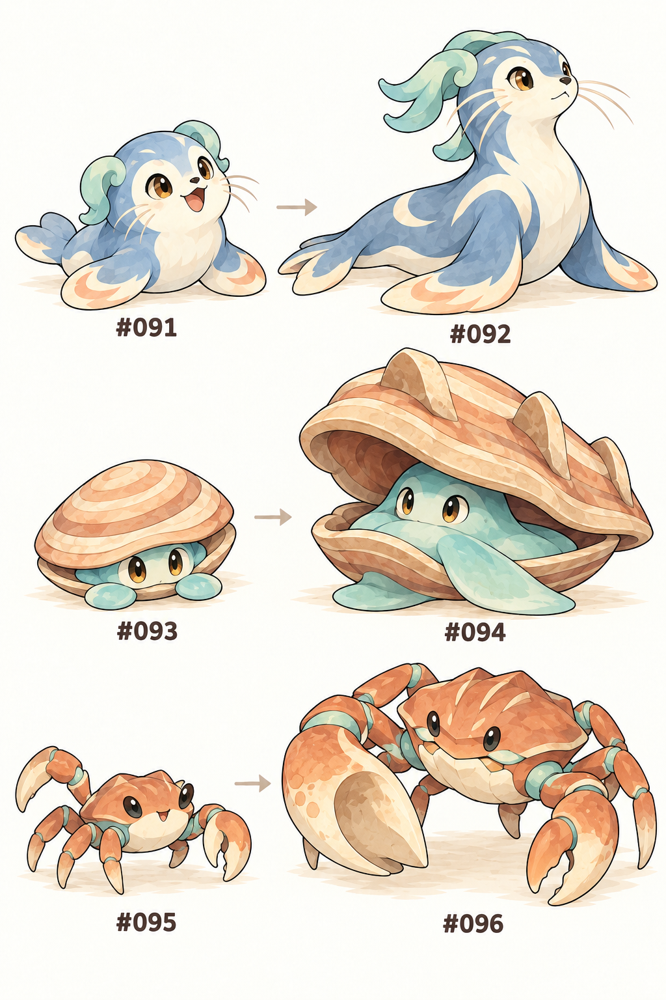
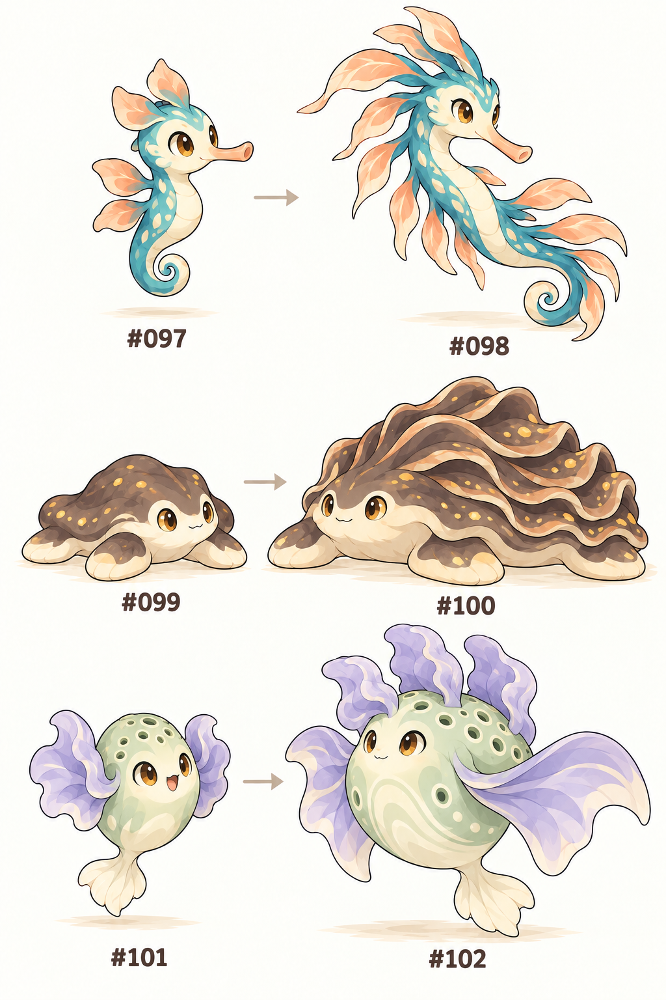

# 모아루 · #091–102 몬스터 기획 v1

상태: **기획 완료 · 구현 대기**. 작성일 2026-10-22. 기존 #001–090 및 지역 개체 #901–909와 함께 사용한다.

번호·이름·외형·생태·진화·등장 구역·퀘스트 역할을 한 항목으로 묶었다. 능력치와 전투 배치는 플레이테스트 전 초안이며 실제 구현·밸런스 검증을 뜻하지 않는다.

## 디자인 기준

초기형은 해안에 처음 도착해 만나고 싶은 작고 친근한 모습, 최종형은 같은 실루엣 특징을 이어받아 생활 능력과 전투 역할이 분명해진다. 물 동료 네 계열을 구조·방파제·둑다짐·해초숲 길잡이로 구별한다. 독 동료는 시설 문제를 알려 주는 생물이며 오염의 원인이나 악당이 아니다.

새 얼음 타입·상태이상·특성 시스템을 이번 장에 추가하지 않는다. 해품범은 물 타입이다. 시트의 숫자가 식별 기준이고, 타입과 진화 조건은 이 문서/JSON을 기준으로 한다.

## #091–096 · 해안의 생활 동료

### #91 포말이 · 물

- **진화:** Lv.34 → #92 해품범.
- **모습:** 연한 안개색 털과 크림 배, 볼마다 짧은 수염 세 가닥. 작은 물거품처럼 둥글고 양쪽 귀끝이 민트색으로 말렸다.
- **성격·생태:** 파도에 떠밀린 조개를 코로 밀어 마른 곳에 옮긴다. 헤엄을 연습하다가 칭찬받으면 두 앞지느러미를 마주 친다.
- **등장:** R13 바깥여울·해무나루 해변.
- **전투 방향:** 체력과 특수방어로 버티는 물 동료.
- **마을·의뢰 역할:** 너울잠굴에서 흘러온 구조용 부표 끈을 따라오는 선택 의뢰의 주인공.
- **탐험 적성:** F07 · F08.
- **능력치 초안(체력/공격/방어/특공/특방/속도):** 70/45/55/55/70/40.
- **기술 후보:** bubble, aquaring, refresh, pulse. 기존 기술 ID를 사용하고 레벨별 학습표 초안은 동봉 JSON의 learnsetProposal에 있다. 실제 전투로 검증한다.

### #92 해품범 · 물

- **진화:** 최종형.
- **모습:** 길어진 유선형 몸, 넓은 앞지느러미와 어깨의 크림색 초승달 무늬. 수염과 귀끝이 뒤로 부드럽게 흐른다.
- **성격·생태:** 물결이 잠잠해지는 곳을 먼저 찾아 뒤따르는 무리에게 알려준다. 지친 동료 곁에서는 물살을 막는 방향으로 몸을 눕힌다.
- **등장:** 해무군도 구조대·바깥여울.
- **전투 방향:** 물 공격·자기 상태 회복·긴 호흡.
- **마을·의뢰 역할:** F08 급류타기 강습의 무료 지원 동료. 포획하거나 진화시킬 필요 없이 교육을 받을 수 있다.
- **탐험 적성:** F07 · F08.
- **능력치 초안(체력/공격/방어/특공/특방/속도):** 105/70/85/80/105/60.
- **기술 후보:** pulse, wave, aquaring, refresh. 기존 기술 ID를 사용하고 레벨별 확정 학습표는 구현 시 진행 레벨에 맞춰 검증한다.

### #93 모래꼼 · 물/바위

- **진화:** 물결돌 1개 → #94 보루패.
- **모습:** 복숭아빛 동심원 껍데기, 안쪽 민트색 몸과 호박색 눈. 혀 대신 넓적한 작은 발 두 갈래가 보인다.
- **성격·생태:** 자기보다 작은 모래알을 꼭 맞춰 쌓으려 한다. 물이 탁해지면 껍데기를 닫고 천천히 맑은 물을 내보낸다.
- **등장:** R13 해변·D09 너울잠굴 물웅덩이.
- **전투 방향:** 느리지만 단단한 방어형 물·바위.
- **마을·의뢰 역할:** 조개밭 관찰 의뢰. 야생 개체를 잡지 않고 관찰만 해도 완료.
- **탐험 적성:** F07.
- **능력치 초안(체력/공격/방어/특공/특방/속도):** 45/45/100/55/55/20.
- **기술 후보:** bubble, rockguard, rockthrow, aquaring. 기존 기술 ID를 사용하고 레벨별 확정 학습표는 구현 시 진행 레벨에 맞춰 검증한다.

### #94 보루패 · 물/바위

- **진화:** 최종형.
- **모습:** 두꺼운 사암색 두 장 껍데기와 뭉툭한 버팀 능선 세 개. 민트색 몸이 넓은 발로 바닥을 잡는다.
- **성격·생태:** 무리의 앞에서 껍데기를 비스듬히 세워 작은 파도를 흘려보낸다. 살아 있는 방파제라고 불리지만 강한 흐름은 스스로 피한다.
- **등장:** 해무군도 얕은 암초.
- **전투 방향:** 높은 방어·느린 물 공격과 바위 견제.
- **마을·의뢰 역할:** 해안 정화소의 취수구를 지키는 생활 동료. 주 퍼즐은 수동 장치로도 해결.
- **탐험 적성:** F07.
- **능력치 초안(체력/공격/방어/특공/특방/속도):** 80/70/140/80/80/30.
- **기술 후보:** pulse, rockslide, rockguard, aquaring. 기존 기술 ID를 사용하고 레벨별 확정 학습표는 구현 시 진행 레벨에 맞춰 검증한다.

### #95 찰칵게 · 물/땅

- **진화:** Lv.32 → #96 제방집게.
- **모습:** 테라코타색 둥근 갑각, 옅은 물빛 마디. 걷는 다리 네 개와 집게 두 개, 한쪽 집게가 조금 큰 삽 모양이다.
- **성격·생태:** 젖은 모래를 집게로 눌러 작은 둑을 만든다. 완성한 둑을 파도가 넘으면 성을 내는 대신 더 넓게 다시 쌓는다.
- **등장:** R13 해변·R16 제방들길.
- **전투 방향:** 물·땅 공격을 번갈아 쓰는 방어형.
- **마을·의뢰 역할:** 제방 주민의 흙길 손질을 돕는 선택 장면에 등장. 여섯 부속지 실루엣 고정.
- **탐험 적성:** F02 · F06.
- **능력치 초안(체력/공격/방어/특공/특방/속도):** 50/60/80/60/45/30.
- **기술 후보:** bubble, mudshot, pinch, harden. 기존 기술 ID를 사용하고 레벨별 확정 학습표는 구현 시 진행 레벨에 맞춰 검증한다.

### #96 제방집게 · 물/땅

- **진화:** 최종형.
- **모습:** 넓은 육각 갑각, 낮은 등 능선 세 줄. 네 개의 낮고 튼튼한 보행 다리와 두 집게, 큰 집게는 넓은 둑다짐 삽이다.
- **성격·생태:** 물이 새는 지점을 먼저 살피고 흙을 눌러 보강한다. 사람들이 세운 둑과 자신이 만든 둑을 같은 길로 여긴다.
- **등장:** 제방·운송도시 하천.
- **전투 방향:** 전기 무효·물과 땅의 혼합 견제, 풀에 큰 약점.
- **마을·의뢰 역할:** 운송도시 관장 팀과 수문 정비 현장에서 등장. 물 기술은 현행 엔진의 특수 판정을 그대로 사용.
- **탐험 적성:** F02 · F06 · F09.
- **능력치 초안(체력/공격/방어/특공/특방/속도):** 85/85/110/85/70/45.
- **기술 후보:** wave, mudshot, quake, rockguard. 기존 기술 ID를 사용하고 레벨별 확정 학습표는 구현 시 진행 레벨에 맞춰 검증한다.

## #097–102 · 해초숲과 정화시설

### #97 실해마 · 물

- **진화:** Lv.40 → #98 해룡결.
- **모습:** 밝은 청록색 긴 코와 가는 말린 꼬리, 살구빛의 작은 잎 모양 지느러미. 작은 해초처럼 세로로 떠 있다.
- **성격·생태:** 해초에 꼬리를 걸고 쉬다가 같은 물살을 따라 무리째 움직인다. 길을 잃으면 작은 방울 소리를 낸다.
- **등장:** R13 바깥여울·R15 굽이강 어귀.
- **전투 방향:** 빠른 물 특수 공격, 성장 후 드래곤 견제.
- **마을·의뢰 역할:** 해초밭 선택 탐험의 관찰 대상. 포획은 이야기·수상 이동의 조건이 아니다.
- **탐험 적성:** F07 · F08.
- **능력치 초안(체력/공격/방어/특공/특방/속도):** 45/45/50/75/55/65.
- **기술 후보:** bubble, pulse, twister, agility. 기존 기술 ID를 사용하고 레벨별 확정 학습표는 구현 시 진행 레벨에 맞춰 검증한다.

### #98 해룡결 · 물/드래곤

- **진화:** 최종형.
- **모습:** 가늘고 긴 해룡 몸통, 길게 말리는 꼬리와 살구색 잎 지느러미가 등에서 물결처럼 이어진다. 뿔 대신 낮은 잎관이다.
- **성격·생태:** 먼 바다로 나가는 새끼들이 따라올 수 있도록 같은 자리를 크게 돌아 준다. 해초 숲에서 몸을 흔들면 물결 방향이 드러난다.
- **등장:** 해초숲·굽이강 하구.
- **전투 방향:** 빠른 물 특수 공격과 기존 드래곤 보조 공격.
- **마을·의뢰 역할:** 느린 고화력 용솟치와 달리 속도·물 특수 공격이 중심. 드래곤 기술은 현행 타입 판정에 따라 물리로 계산.
- **탐험 적성:** F07 · F08.
- **능력치 초안(체력/공격/방어/특공/특방/속도):** 75/75/75/105/80/95.
- **기술 후보:** pulse, wave, dragonbreath, agility. 기존 기술 ID를 사용하고 레벨별 확정 학습표는 구현 시 진행 레벨에 맞춰 검증한다.

### #99 진득이 · 독

- **진화:** Lv.38 → #100 회수렁.
- **모습:** 짙은 점토색 납작한 몸에 옅은 황금 알갱이, 크림색 밑면. 손 대신 넓은 주름발 네 갈래와 낮은 호박색 눈이 있다.
- **성격·생태:** 물밑에 가라앉은 찌꺼기를 조금씩 모아 먹는다. 먹을 수 있는 양보다 찌꺼기가 많아지면 쉬러 나와 몸을 말린다.
- **등장:** D10 침전수로·R17 돌바퀴 언덕.
- **전투 방향:** 공격과 체력 중심 독 동료.
- **마을·의뢰 역할:** 정화시설의 과부하를 알려 주는 생물. 오염 원인으로 몰아 퇴치하는 퀘스트를 만들지 않는다.
- **탐험 적성:** 별도 기술 없음.
- **능력치 초안(체력/공격/방어/특공/특방/속도):** 65/75/55/45/65/20.
- **기술 후보:** acid, sludge, venomjab, harden. 기존 기술 ID를 사용하고 레벨별 확정 학습표는 구현 시 진행 레벨에 맞춰 검증한다.

### #100 회수렁 · 독

- **진화:** 최종형.
- **모습:** 낮고 넓어진 점토색 몸, 등 가장자리를 따라 층층이 접힌 주름 일곱 줄. 금빛 알갱이는 몸속 침전물의 자연 무늬다.
- **성격·생태:** 먹은 찌꺼기를 몸속에서 안정시켜 둔다. 한도를 넘기 전에 물 밖으로 나와 쉬기 때문에 작업자는 쉬는 무리를 보고 설비를 점검한다.
- **등장:** 정화시설 휴식대·제방 가장자리.
- **전투 방향:** 큰 체력과 독 물리 공격, 특수 물·땅에 견제됨.
- **마을·의뢰 역할:** 5관장 팀과 정화소 직원의 생활 동료. 독을 이유로 악당·오염의 근원으로 묘사하지 않는다.
- **탐험 적성:** 별도 기술 없음.
- **능력치 초안(체력/공격/방어/특공/특방/속도):** 100/105/80/65/95/35.
- **기술 후보:** venomjab, sludge, bodyslam, rockguard. 기존 기술 ID를 사용하고 레벨별 확정 학습표는 구현 시 진행 레벨에 맞춰 검증한다.

### #101 후욱이 · 독

- **진화:** Lv.35 → #102 환기둥.
- **모습:** 연한 세이지색 배 모양 공기주머니 몸, 라벤더색 여과 주름 두 개와 짧은 크림색 꼬리지느러미. 작은 통풍 구멍은 원형이고 표정은 호기심 많다.
- **성격·생태:** 몸에 모은 기체를 아주 조금씩 내보내며 떠오른다. 막힌 바람길 근처에서는 둥실둥실 같은 자리를 돈다.
- **등장:** R14 바닷솔길·D10 정화시설.
- **전투 방향:** 방어·독 보조에서 비행 복합으로 성장.
- **마을·의뢰 역할:** 환기 점검 의뢰의 관찰 대상. 기체를 들이마시거나 불로 태워 제거하는 행동은 없음.
- **탐험 적성:** 별도 기술 없음.
- **능력치 초안(체력/공격/방어/특공/특방/속도):** 45/45/80/60/55/40.
- **기술 후보:** poisongas, acid, gust, harden. 기존 기술 ID를 사용하고 레벨별 확정 학습표는 구현 시 진행 레벨에 맞춰 검증한다.

### #102 환기둥 · 독/비행

- **진화:** 최종형.
- **모습:** 하나로 이어진 넓은 세이지색 부유 몸체, 옆으로 펼친 라벤더색 막지느러미와 위로 선 부드러운 여과 주름 세 개. 한 얼굴, 해골·기계·복수 머리 없음.
- **성격·생태:** 연결된 여러 환기구 사이를 돌며 막힌 흐름을 감지한다. 흐름이 풀리면 몸이 가볍게 펴져 작업자들이 멀리서도 알아본다.
- **등장:** 푸른숨시 환기탑·정화시설.
- **전투 방향:** 높은 방어·독 특수 공격·비행 견제, 전기·에스퍼·바위 약점.
- **마을·의뢰 역할:** 5관장 에이스. 땅 무효는 비행 타입에서만 오며 미구현 특성을 새로 붙이지 않는다.
- **탐험 적성:** 별도 기술 없음.
- **능력치 초안(체력/공격/방어/특공/특방/속도):** 75/65/115/90/80/65.
- **기술 후보:** sludge, aircut, poisongas, harden. 기존 기술 ID를 사용하고 레벨별 확정 학습표는 구현 시 진행 레벨에 맞춰 검증한다.

## 진화와 획득 보장

- #091→092 Lv34, #095→096 Lv32, #097→098 Lv40, #099→100 Lv38, #101→102 Lv35. 플레이어가 거절 가능하며 다음 레벨업에 다시 제안한다.
- #093→094는 기존 물결돌이다. 세 번째 배지 이후의 고정 의뢰·반복 교환을 그대로 유지하고, 3장 SQ3-02로 무료 1개를 추가한다. 전투 기술을 놓치지 않도록 현재 레벨 이하의 선조 기술을 무료 복습한다.
- #091·093·095·097은 파도타기를 이미 얻은 뒤 만난다. 이들을 포획해야 파도타기를 배우는 구조가 아니다.
- F08 강습은 대여 해품범, F09 강습은 대여 산받곰을 제공한다. 대여 동료는 포획·도감 등록·전투·교환에 쓰지 않는다.
- 물 기술은 현행 엔진에서 특수 공격이다. 제방집게를 순수 물리 물 어태커로 잘못 구현하지 않는다. 해룡결의 드래곤 기술도 현행 물리 판정을 문서상 유지한다.
